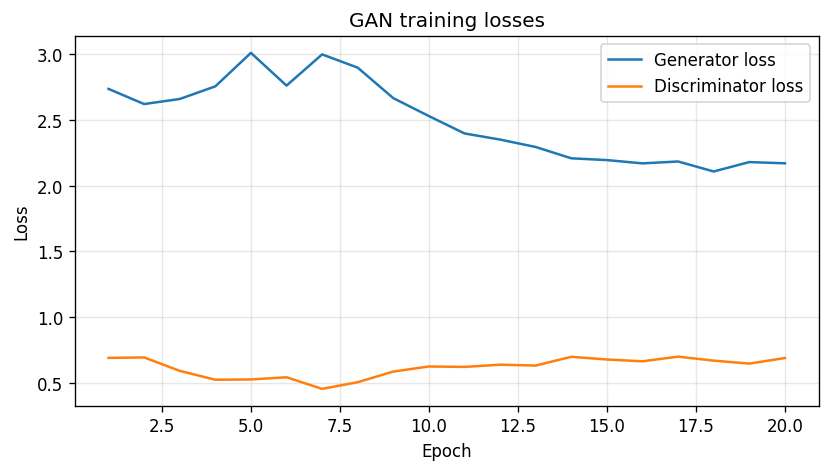
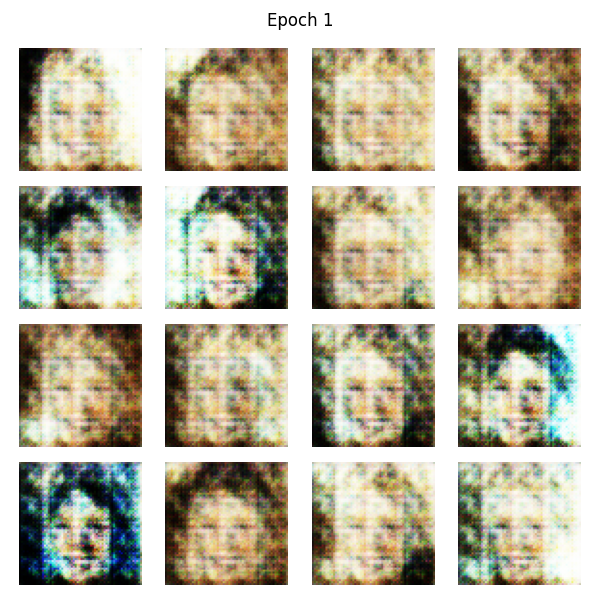
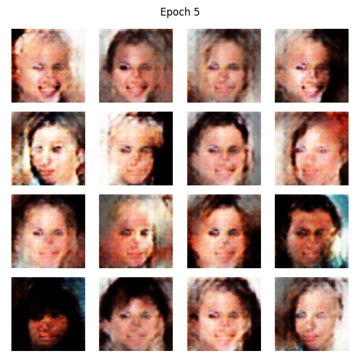
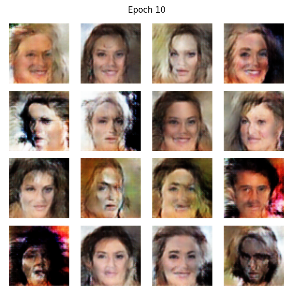
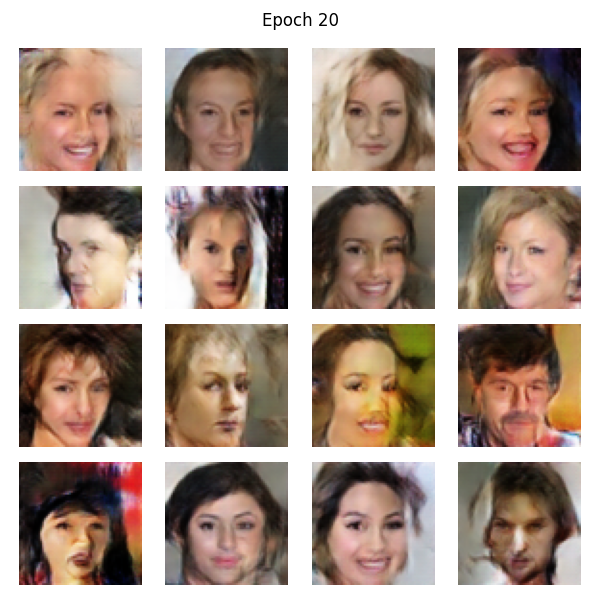
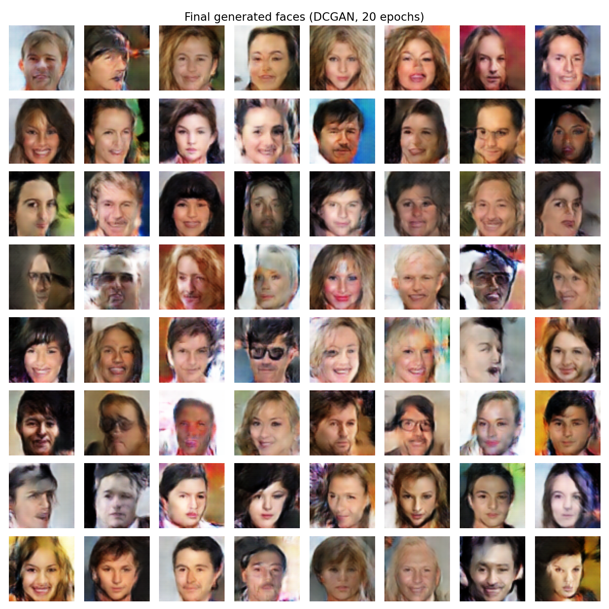

# Realistic Human Face Generation using DCGAN

A Deep Convolutional GAN (DCGAN) built with TensorFlow/Keras that generates 64×64 synthetic human face images from random noise. Trained on a 50,000-image subset of CelebA.

## Overview

The goal of this project is to understand how GANs generate new images by building and training both networks from scratch:

- **Generator:** maps a 100-dimensional random vector to a 64×64×3 face image.
- **Discriminator:** classifies an image as real or generated.
- Both are trained adversarially, and generated samples are saved during training to track progress.

## Dataset

- **CelebA** (CelebFaces Attributes), obtained from Kaggle: `jessicali9530/celeba-dataset` (202,599 images, 178×218 each).
- A random subset of **50,000 images** (fixed seed) is used to keep training time practical.

### Preprocessing

1. Center crop to 148×148 to focus on the face.
2. Resize to 64×64.
3. Normalize pixel values from [0, 255] to [-1, 1], matching the Generator's `tanh` output.

## Model Architecture

| Component | Details | Parameters |
|---|---|---|
| Generator | Noise (100) → 4×4 → 8×8 → 16×16 → 32×32 → 64×64 using `Conv2DTranspose`, BatchNorm, ReLU, `tanh` output | 3,578,624 |
| Discriminator | 64×64 → 32×32 → 16×16 → 8×8 → 4×4 using strided `Conv2D`, BatchNorm, LeakyReLU(0.2), single logit output | 2,767,361 |

Weights are initialized from a normal distribution (mean 0, std 0.02), following the DCGAN paper.

## Training Setup

| Setting | Value |
|---|---|
| Image size | 64×64 |
| Batch size | 128 |
| Epochs | 20 |
| Latent dimension | 100 |
| Loss | Binary cross-entropy (from logits) |
| Optimizer | Adam, learning rate 2e-4, beta_1 = 0.5 (both networks) |
| Training time | about 64 seconds per epoch on a Kaggle GPU |

A fixed noise vector is used to generate samples after every epoch, so progress can be compared on the same inputs.

## Results

### Training losses



The Generator loss decreased from about 3.0 to 2.2 and then stabilized, while the Discriminator loss stayed around 0.5–0.7. Training remained stable, with no collapse of either network.

### Progress over epochs

| Epoch 1 | Epoch 5 |
|---|---|
|  |  |

| Epoch 10 | Epoch 20 |
|---|---|
|  |  |

### Final generated faces



## Limitations

- After 20 epochs the faces are recognizable and diverse, but **not photorealistic**.
- Roughly a quarter of the samples show visible artifacts, such as asymmetric eyes or mouths and unnatural color patches.
- Images are soft because of the low 64×64 resolution and short training.
- No quantitative metric (such as FID) was computed. Quality was judged visually only.

## Possible Improvements

- Train for more epochs and use the full dataset.
- Add a quantitative evaluation such as FID.
- Try a larger resolution or more stable GAN variants (for example WGAN-GP).

## Repository Structure

```
├── face_gan_notebook.ipynb   # full code: data, models, training, results
├── generator.keras           # trained Generator
├── images/                   # loss curve, epoch samples, final faces
└── README.md
```

## How to Run

1. Open the notebook on Kaggle and add the dataset `jessicali9530/celeba-dataset` as an input.
2. Enable a GPU accelerator.
3. Run all cells in order.

To generate new faces from the saved model:

```python
import tensorflow as tf

generator = tf.keras.models.load_model("generator.keras")
noise = tf.random.normal((16, 100))
images = (generator(noise, training=False) + 1) / 2   # scale to [0, 1]
```

## Tech Stack

Python, TensorFlow/Keras, NumPy, Matplotlib, Pillow.
